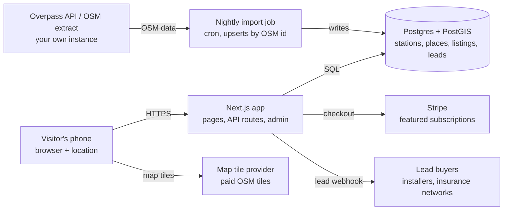

# TeslaSuperchargerNearMe.com PRD

Oct 4, 2026 · Nebiyu

## Overview

TeslaSuperchargerNearMe.com is a mobile-first web app that turns about 673,000 monthly "Supercharger near me" visitors into revenue from featured local listings, lead generation, ads and affiliate links.

**Who it serves.** Mostly non-Tesla EV drivers who arrive from Google search, often standing at or driving to a charger. They want the nearest Supercharger, and something to do during a 20 to 40 minute charge.

**What it does.** Finds Superchargers near the visitor on an OpenStreetMap map, then shows a station page with charger details and the food, coffee, grocery, bar and wine places within walking distance. Paid listings take the #1 spot in each category.

**Goals for the first 90 days after launch**

| Goal | Measure | Target |
| --- | --- | --- |
| Keep Google visitors | Bounce rate on home page | [TARGET %] |
| Get visitors to a station page | Home → station page click-through | [TARGET %] |
| Sell featured spots | Paying businesses | [TARGET COUNT] |
| Generate leads | Charger install + insurance leads per month | [TARGET COUNT] |
| Fast on phones | Largest Contentful Paint on 4G | under 2.5 s |

## Scope

The MVP ships three screens (Home, Map, Station page) plus a simple business sign-up for featured spots; everything else waits for later phases.

| Feature | Priority | Phase |
| --- | --- | --- |
| Home screen with search, Near me, Map, Favorites | P0 | MVP |
| Map of nearby Superchargers (OSM tiles + station data) | P0 | MVP |
| Station page: details, stall count, price placeholder | P0 | MVP |
| "While you charge" places by category, with walking time | P0 | MVP |
| Charge-time filter (Any, 15, 30, 45+ min) | P0 | MVP |
| Featured #1 listing per category (paid) | P0 | MVP |
| "Save on your EV" lead card (home charger, insurance) | P0 | MVP |
| Business "Get featured" sign-up and payment | P1 | MVP |
| Display ads slots | P1 | MVP |
| Favorites saved on device | P1 | MVP |
| Optional accounts (email code sign-in): favorites synced across devices, business dashboard | P2 | MVP+ |
| City pages for SEO ("Superchargers in [city]") | P1 | Phase 2 |
| Crowd reports (working, busy, broken) | P2 | Phase 2 |
| Station photos from drivers (upload, automatic face and plate blurring, admin approval) | P1 | Phase 2 |
| Live free-stall counts via data partner | P2 | Phase 3 |
| Route planner: Superchargers along a trip, by vehicle and range (Home button replaces Map) | P1 | MVP+ |

**Out of scope for the MVP:** native iOS and Android apps, payment for charging, and live stall availability. Accounts are optional: every feature works signed out.

## User flow

A Google visitor reaches a station page in two taps: Home → Near me → a station.

1. Visitor searches "Tesla Supercharger near me" and lands on **Home**.
2. Visitor taps **Near me** (or **Map**). The browser asks for location.
    1. Allowed: the **Map** centers on them and lists the nearest Superchargers.
    2. Denied: the Map shows a message and the search box; nothing breaks.
3. Visitor taps a pin or a list row and opens the **Station page**.
4. On the Station page, the visitor picks a category and a charge time, then taps the #1 featured offer or a free listing for directions.
5. Optional: visitor submits a ZIP code in the "Save on your EV" card and becomes a lead.

Typing a city or address in the search box on Home or Map goes straight to the Map for that place. The back button on Map returns to Home.

## Screen specs

All screens are designed at 390 px wide (phone first) and must work from 320 px to desktop, where content centers in a column of at most 480 px. The design files in `design/` are the visual source of truth.

### Shared header

- Dark bar (`ink` background), 60 to 72 px tall, 16 px side padding.
- Left: brand mark (mint rounded square with a lightning bolt) and the wordmark "TeslaSuperchargerNearMe.com" in the display font, 20 px, bold.
- Right: icon buttons 44 × 44 px, radius 12, background `ink-raised`. Home shows Menu; Station page shows Search and Map; Map shows a Back button on the left.

### Screen 1: Home (Google landing page)

- Content centered vertically and horizontally, 20 px side padding, 22 px gaps.
- Brand mark 76 × 76 px, radius 22, mint background, bolt icon 40 px.
- H1: "Find a Supercharger near you", display font 30 px, bold, letter-spacing −0.6 px.
- Subline: "30 minutes to charge. A whole neighborhood to explore. Your charging stop just got interesting." 15 px, `muted`.
- Search field: full width, 52 px tall, pill radius, 1.5 px `divider` outline with the floating shadow, search icon inside on the left, placeholder "Search city, place or address". Must be a real `<input type="search">` with a label.
- Button grid, 2 columns, 10 px gap, each button 52 px tall, radius 14:
    - **Near me** (primary): `accent` fill, white text, navigation-arrow icon. Requests location, then opens Map.
    - **Map**: white, soft shadow, map icon in `accent`. Opens Map at last known or default location.
    - **Favorites**: spans both columns, 60% width, centered, star icon. Opens saved stations.
- Footer: "Not affiliated with Tesla, Inc." 12 px, `muted`, centered.
- SEO: below the fold, server-render a list of popular cities and a short FAQ so Google sees real content (see SEO section).

### Screen 2: Map (Near me)

- Full-screen map under the header, OpenStreetMap tiles.
- Floating search pill at the top (48 px, white, shadow) and filter chips below it: **Superchargers** (selected, `ink` fill) and **All chargers**.
- Station pins: `accent` pill with a bolt icon and stall count, small stem below.
- Visitor's location: blue dot (#2F6FE4) with white 4 px ring and a soft halo.
- "Center on me" button: 48 × 48 px, white, radius 14, right side.
- Bottom sheet: white, top radius 24, grab handle, title "N Superchargers near you" (display font, 20 px). Rows show icon tile, station name (bold), and "0.6 mi · 24 stalls · 250 kW". Rows sorted by distance, up to 25.
- Attribution line at the bottom of the sheet: "Map data © OpenStreetMap contributors" (required).
- Tapping a pin or row opens that station's page.

### Screen 3: Station page

Sections from top to bottom, 16 px page padding, 14 px between cards, cards white with radius 20.

1. **Station card**
    - Badge "OPEN TO ALL EVs" (`accent-soft` pill, check icon), shown when the station accepts non-Tesla cars.
    - H1 station name, display font 26 px; address line with pin icon.
    - Three stat tiles in a 3-column grid: **Free stalls** (e.g. "7 / 24", shows total stalls until live data exists), **Max speed** (kW), **Price** (per kWh, placeholder until a source is chosen).
2. **"Save on your EV" lead card** (Sponsored)
    - Title, subline "Free quotes. Takes about a minute.", "Sponsored" label top right.
    - Segmented control: **Home charger** | **EV insurance**. Switching changes icon, title, body, three check-mark points, button text and partner line.
    - ZIP code input (5 digits, numeric keypad) and a primary button: "Get install quotes" or "Compare rates".
    - Small print: partner names, "We may be paid when you request quotes.", and the consent text placeholder.
3. **Photos** (see Station photos below), directly above While you charge: an "Add photo" tile, then approved driver photos in a strip that scrolls sideways, newest first. No photos yet: "No photos of this station yet. Charging here? Add the first one."
4. **While you charge**
    - Heading "While you charge" and subline "Everything here is a short walk from the stalls."
    - Charge-time chips: Any, 15 min, 30 min, 45+ min. Filter hides free listings whose typical visit is longer than the chosen time.
    - Category chips (scroll sideways on small screens): **Food & Drink**, **Coffee**, **Grocery**, **Bars & Wine**. Selected chip = `ink` fill, white text.
    - Bars & Wine shows a note: "You'll be driving after this. Look for food and zero-proof options, or pick up a bottle for home."
    - **#1 Featured card** (always first, never filtered out): gold background, gold border, "#1 FEATURED" badge and "Sponsored" label, photo, name, type, walk time, hours, offer line with tag icon, and two buttons (offer action + Directions).
    - **Free listings** numbered from #2, sorted by walking time: rank circle, name, type, "N min walk", "~N min visit", hours in `accent`, and a Directions icon button.
    - Empty state: "Nothing else fits that time. Try a longer charge."
5. **Get featured banner**: dark card, "Own a business near this station?", one line of pitch, mint button "Get featured · [PRICE]/mo" that opens the business sign-up.
6. **Footer**: "Not affiliated with Tesla, Inc." and "Sponsored listings are clearly labeled."

## Design system

One dark-green ink, one mint highlight, one gold for paid placements; define these as CSS variables (or Tailwind theme tokens) and use nothing else.

### Colors

| Token | Hex | Used for |
| --- | --- | --- |
| `ink` | #14211C | Header, primary text, selected chips, dark banner |
| `ink-raised` | #24342E | Icon buttons on the header |
| `ground` | #F3F5F2 | Page background, stat tiles |
| `surface` | #FFFFFF | Cards, sheets, inputs |
| `muted` | #56635D | Secondary text, labels |
| `border` | #CFD8D3 | Form field borders |
| `divider` | #E6EBE8 | List row dividers; chip, search field and secondary-button outlines |
| `accent` | #0B6E5B | Primary buttons, pins, links, stall numbers |
| `accent-hover` | #08513F | Hover and pressed states |
| `accent-soft` | #E2F0EB | Badges, icon tiles |
| `mint` | #3DDC97 | Brand mark, button on dark banner |
| `gold-bg` | #FFF6E0 | Featured card background |
| `gold-border` | #E2B04A | Featured card border |
| `gold-ink` | #7A4E00 | Featured badge, buttons, labels |
| `gold-text` | #5C4410 | Featured card secondary text |
| `location` | #2F6FE4 | User location dot |
| `other-network` | #6B4FBB | Route planner: other networks' chargers (pins, labels); white text on it passes |
| `other-network-soft` | #EFEAFB | Route planner: other-network badge background |

Text colors must meet 4.5:1 contrast on their background. White on `accent` and on `gold-ink` passes.

### Type

| Role | Font | Size / weight |
| --- | --- | --- |
| Display (H1, headings, numbers, wordmark) | Bricolage Grotesque | 30 / 700 home H1; 26 / 700 station H1; 18–22 / 700 section headings |
| Body | Figtree | 15 / 400 body; 14 / 600 meta; 13 / 600 labels; 11–12 small print |

Load both from Google Fonts with `display=swap`. Fall back to `system-ui, sans-serif`.

### Spacing, shape and depth

- Spacing scale: 4, 6, 8, 10, 12, 14, 16, 18, 20, 22 px. Page padding 16 px (Home 20 px).
- Radius: cards 20, featured card 20, sheets 24 (top), buttons 12–14, chips and pills 999, icon tiles 12–14, brand mark 10 (header) and 22 (home).
- Shadows: a 1 px hairline ring plus a soft, long drop, all in `ink` at low opacity. Cards `0 0 0 1px rgba(20,33,28,0.04), 0 1px 2px rgba(20,33,28,0.04), 0 12px 32px -16px rgba(20,33,28,0.14)`; floating controls `0 0 0 1px rgba(20,33,28,0.05), 0 4px 12px -2px rgba(20,33,28,0.12), 0 16px 32px -12px rgba(20,33,28,0.18)`.
- Finish: primary buttons get a faint white sheen on top and a soft `accent` glow below; the brand mark gets a soft highlight. Map tiles keep their full color. Chip, input and secondary-button outlines use `divider`. Press feedback is a 0.98 scale, off under reduced motion.
- Touch targets at least 44 × 44 px everywhere.

### Components

- **Button**: primary (`accent`), secondary (white + shadow), gold (featured), mint (on dark). Height 44–52 px.
- **Chip**: 44 px tall pill; selected = `ink` fill, white text; unselected = white with `divider` outline. Use `aria-pressed`.
- **Segmented control**: `ground` track with 4 px padding; selected segment white with shadow.
- **Stat tile**, **list row**, **featured card**, **bottom sheet**, **badge** as described in Screen specs.
- **Icons**: simple stroke icons (Lucide is a good match): bolt, search, map, menu, pin, navigation arrow, star, tag, check, chevron, home, shield. No emoji in the UI.

## Monetization

Four revenue streams share every station page; featured listings and leads come first because they earn the most per visitor.

| Stream | Where it shows | How it pays |
| --- | --- | --- |
| Featured #1 listing | Top of each category on a station page | Monthly subscription per business per station: [PRICE]/mo |
| Lead generation | "Save on your EV" card (home charger, insurance) | Paid per lead or per click by partners or lead networks |
| Display ads | One slot below the lead card, one below the listings | Ad network revenue per 1,000 views |
| Affiliate links | Featured offers (reservations, grocery pickup), future adapter links | Commission per sale |

### Featured listing rules

- Three paid spots per category per station: **#1 Featured** (the large gold card) and **#2 / #3 Sponsored** (smaller gold-bordered cards right below). One live business per spot. Ties go to the earlier sign-up; a waitlist holds the rest.
- The business picks a spot when applying (taken spots are shown as taken; if all three are taken it can still apply for the waitlist). Admin can move a listing between free spots.
- A business must be within the walking radius (default 600 m) of the station it pays for.
- Paid spots always come first, in spot order, and are never hidden by the charge-time filter. Free places follow by walking time, numbered after them; a paid business isn't listed again among the free places.
- Always labeled "Sponsored": "#1 FEATURED" on the large card, "#2 SPONSORED" / "#3 SPONSORED" on the smaller ones.
- Fields: name, type line, photo, hours, offer text (max 50 characters), action button label and URL, directions coordinates, spot (1–3).
- Unsold spots leave no gaps: whatever is sold moves up (if only #2 is sold, it shows first as a smaller sponsored card, numbered 1), then the free listings.

### Business sign-up ("Get featured")

1. Business picks a station and a category; the app confirms it is within the walking radius.
2. Business enters listing details and uploads a photo.
3. Business pays by card through Stripe Checkout (subscription). The app never handles card numbers itself.
4. An admin approves the listing before it goes live.

### Tracking

Record views and clicks per featured listing and per lead card, so you can send each business a monthly report ("X drivers saw you, Y tapped your offer"). This report is the main renewal pitch.

## Data and technical architecture

A Next.js app serves pages from its own Postgres database, which a nightly job fills from OpenStreetMap; visitors never wait on Overpass.

The browser loads map tiles straight from the tile provider; every other request goes through the app.

### Stack

| Layer | Choice |
| --- | --- |
| App and server | Next.js (App Router) with TypeScript, server-rendered pages |
| Styling | Tailwind CSS with the design tokens above |
| Map | Leaflet (or MapLibre GL), loaded only on the Map screen |
| Map tiles | A paid OpenStreetMap tile provider; never tile.openstreetmap.org in production |
| Database | Postgres with PostGIS for distance queries |
| Payments | Stripe Checkout and Stripe Billing |
| Hosting | Vercel (or similar) plus managed Postgres (Supabase or Neon) |
| Analytics | Privacy-friendly page analytics plus an events table for listing views and clicks |

### Data model

| Table | Key fields |
| --- | --- |
| `stations` | id, osm_id, name, slug, location (geography), address, city, state, stalls, max_kw, open_to_all, price_per_kwh (nullable), updated_at |
| `places` | id, osm_id, name, category (food, coffee, grocery, bars), subtype, location, opening_hours, typical_visit_min, updated_at |
| `station_places` | station_id, place_id, distance_m, walk_min (precomputed) |
| `businesses` | id, name, contact_email, phone |
| `featured_listings` | id, business_id, station_id, category, offer_text, cta_label, cta_url, photo_url, status (pending, live, paused), stripe_subscription_id, starts_at, ends_at |
| `leads` | id, type (install, insurance), zip, name, phone, email, station_id, consent_text, consent_at, page_url, delivered_to, status |
| `events` | id, type (view, click), listing_id or lead_type, station_id, created_at |
| `station_photos` | id, station_id, photo_path, thumb_path, width, height, caption (max 120 characters), email, ip_hash, blur_status (blurred, none_found, skipped, failed), blurred_areas, status (pending, approved), created_at, reviewed_at. Rejected photos are deleted |
| `favorites` | user_id (Supabase Auth user), station_id, name, address, href, created_at. Row Level Security: each account reads and writes only its own rows |

### Import job

- Runs nightly (GitHub Actions, `.github/workflows/refresh-stations.yml` running `app/scripts/refresh-stations.mjs`). Stations come from OpenStreetMap, checked against supercharge.info: open sites OSM lacks are added, entries that aren't open Superchargers (closed, duplicates, planned) are removed, and temporarily closed stations stay listed with a notice. Outside the US, stations come from supercharge.info.
- Places within 600 m of each station: restaurants, fast food, cafés, bars and pubs, supermarkets, convenience, greengrocers, wine and alcohol shops, and other shops, from OpenStreetMap plus the Overture Maps places OSM lacks (10 closest per category).
- Station ids and URLs never change. A removed station's URL permanently redirects to the nearest listed station. A safety brake stops the run when a feed would remove more than 5% of stations.
- Walking time = straight-line distance at 80 m per minute (upgrade to walking routes later).
- Typical visit minutes come from category defaults: convenience 5, café 10, wine shop 15, fast food 15, supermarket 20, restaurant 40, bar 45.
- For the whole US, use a Geofabrik extract processed with osmium, or your own Overpass server; the public Overpass server has fair-use limits.
- `reference/near-me-map.html` shows working Overpass queries for stations and walkable places.

### API routes

- `GET /api/stations/near?lat&lng&limit=25` — nearest stations by distance.
- `GET /api/stations/[id]/places?category&maxVisit` — featured listing first, then free places by walk time.
- `POST /api/leads` — validates and stores a lead with consent, then sends it to the buyer.
- `POST /api/featured/checkout` — starts a Stripe Checkout session for a listing.
- `POST /api/stripe/webhook` — activates or pauses listings on payment events.
- `POST /api/events` — records listing and lead-card views and clicks.
- `POST /api/stations/[id]/photos` — upload of one photo with an optional caption and the uploader's email; saved as pending.

### Route planner

- `/route-planner` (Home's second button; Map stays in the menu). Inputs: start (address, ZIP or "Use my location"), destination, and the driver's car: Year → Make → Model from the EPA's fueleconomy.gov data (`data/ev-models.json`, refreshed with `node scripts/import-ev-models.mjs`), which fills in the official range (editable), plus the charging port for non-Tesla cars (NACS, CCS with adapter, CCS only). Cars not listed: type the range. The car is remembered on the device. Every trip assumes leaving with 80%.
- `GET /api/route-plan?from&to&range&plug` — openrouteservice (`ORS_API_KEY`, server-only) for address search and the driving route; US ZIPs are looked up locally.
- Stops: stations within ~5 mi of the route. Stop when the battery is down to 10–15% (a 350-mile car first stops after ~227–245 miles), at the fastest station in that band; never arrive below 10%. Charge to 80%; the last stop charges only what the destination needs (+5%), up to 90% if that saves a stop. Before a gap in the network, charge enough to cross it (up to 100%). Superchargers come first: another network's fast charger (US DOE Alternative Fuels Data Center, `data/fast-chargers.json`, refreshed with `node scripts/import-fast-chargers.mjs`) is used only where Superchargers can't bridge a gap, and is shown in `other-network` purple with its network name and a Directions link. Plugs: NACS cars use Superchargers and NACS plugs elsewhere (CCS plugs too if they carry a CCS adapter); CCS cars with a NACS adapter use everything; CCS-only cars use Magic Dock Superchargers and CCS chargers.
- Each stop shows arrival charge, rough charge time and what's nearby, linking to the station page. Trips typed in are cached by the CDN; trips from the visitor's location are never cached.
- Attribution: "© openrouteservice.org by HeiGIT" with the OpenStreetMap credit.

### Station photos

Goal: give every station page pictures no other site has (where the stalls are, what's around them), so each page stands out for its own area. Photos come only from drivers on our site, never copied from Google, Yelp or Tesla.

- **Who can upload:** anyone; no account needed. The uploader gives an email address (never shown; for questions about the photo) and confirms: "I took this photo, and TeslaSuperchargerNearMe.com may show it on this site."
- **Upload page:** `/supercharger/[state]/[city]/[slug]/add-photo` (not indexed), opened from the "Add photo" tile. Two buttons: **Take a photo** (opens the camera) and **Choose from your photos**. Optional description, e.g. "Stalls are on the 2nd floor of the parking garage, near the mall entrance." One photo at a time; files up to 20 MB. The phone shrinks the photo to 2048 px as a JPEG before sending (also turns iPhone HEIC into JPEG); the server takes up to 4 MB.
- **Processing:** on the server, turn upright, resize to at most 1600 px plus a 480 px thumbnail, save as WebP. Re-encoding removes all metadata (GPS location, time, camera). Originals are not kept.
- **Automatic blurring:** Google Cloud Vision (`GOOGLE_VISION_API_KEY`) finds faces, objects labeled as license plates, and text on cars (plates Vision doesn't label); those areas are blurred before saving. Without the key, or if Vision fails, the photo is saved unblurred and `/admin` flags it for a closer look.
- **Storage:** Supabase Storage, public bucket `station-photos`, files with random names cached for a year. Only `lib/photoStorage.ts` touches it, so moving to Cloudflare R2 later is a one-file change.
- **Review:** every photo waits in `/admin` ("Station photos to review") until approved. Approve publishes it; Reject deletes the record and files. Approved photos can be deleted. We get an email for each new photo.
- **Limits:** 5 uploads per email address and 10 per network address per day (the address is stored only as a keyed hash).
- **Display:** up to 24 approved photos, newest first. Each thumbnail links to the full photo (works without JavaScript); with JavaScript a tap opens a full-screen viewer: swipe, Previous/Next buttons or arrow keys, Escape or × to close, "2 of 5" counter, caption and "Driver photo · [Month Year]".
- **SEO:** photos are in the server-rendered HTML with alt text from the station address, e.g. "Tesla Supercharger at 565 Compass Pt Plz, Leesburg, VA, driver photo 1", plus the caption. Station structured data lists approved photos as `image`. Thumbnails after the first three lazy-load.
- **Legal:** Terms of Use section 5 "Photos You Upload" (uploader keeps ownership and gives us a license to show the photo; we may remove any photo). Privacy policy covers uploaded photos, the email, Google Cloud Vision and retention. Photos of stations can show Tesla's logo on the stalls; include this in the trademark attorney's review.
- **Done when:** a visitor can take or pick a photo on a phone and send it; the stored file has no metadata and is resized, with faces and plates blurred; it appears only after admin approval; the station page shows the empty state without photos and the strip and viewer with them; the page still renders all text without JavaScript.

### Accounts (optional)

- Supabase Auth, sign-in by emailed code (the email also has a link). New emails get an account automatically.
- `/login` → `/account` (favorites link, business dashboard, sign out). `/auth/confirm` handles the email link.
- Favorites stay on the device; signed-in visitors also sync them to `favorites` (three-way merge, so removals on one device carry over).
- `/business/dashboard` lists the Featured requests whose contact email matches the signed-in email.
- Pages served from the CDN never read the session on the server; only the signed-in pages do.

## SEO, compliance and legal

The site must keep its Google traffic and stay clear of trademark, advertising and consent problems from day one.

### SEO

- Server-render every page (no blank page waiting for JavaScript). Home must show real text, not only a search box.
- One indexable page per station: `/supercharger/[state]/[city]/[station-slug]`, with a unique title such as "[Station name] Supercharger — stalls, prices and what's nearby".
- City pages: `/superchargers/[state]/[city]`, listing every station in that city (Phase 2).
- Station pages carry structured data (schema.org `Place` with geo coordinates) and a short, unique description.
- Generate `sitemap.xml` from the station table; refresh it with each data import.
- Keep the domain's existing URLs working; add 301 redirects for any that change.
- Performance budget: under 200 KB of JavaScript on first load; lazy-load the map library on the Map screen only.

### Compliance

- **Trademark:** "Not affiliated with Tesla, Inc." on every page. Do not use Tesla's logo or styling. Get a trademark attorney's review before launch.
- **Sponsored labels:** every paid placement and the lead card are labeled "Sponsored" (FTC endorsement and advertising rules).
- **Lead consent:** the ZIP-code step leads to a form for name, phone and email with the consent wording supplied by your lead buyer or lawyer, shown before submit. Store the consent text, time and page with each lead.
- **Insurance leads:** use a licensed lead network or partner; many states regulate who may collect and pass on insurance leads.
- **Alcohol:** Bars & Wine keeps the driving note; bar listings highlight food and zero-proof options. Check ad network rules before running alcohol ads.
- **Privacy:** ask for location only when the visitor taps Near me; never store exact location on the server. Add a privacy policy, a cookie banner where required, and a "Do not sell or share" link for state privacy laws.
- **OpenStreetMap:** show "© OpenStreetMap contributors" on every map and station page (ODbL license).

## Milestones, acceptance and build notes

Build in four milestones, each one shippable, so you can put the Home and Map live first and add money features after.

1. **M1 — Data:** project setup, database, nightly OSM import of Superchargers and nearby places.
2. **M2 — Core screens:** Home, Map, Station page with free listings, filters and design system. Deploy to the domain.
3. **M3 — Money:** featured listings, lead card and lead form, ad slots, admin panel, Stripe sign-up.
4. **M4 — Growth:** city pages, sitemap, crowd reports, station photos, monthly business reports.

### Acceptance criteria (MVP)

- [ ] Home loads in under 2.5 s on a mid-range phone over 4G and renders its text without JavaScript.
- [ ] Near me asks for location once; allowed shows the 25 nearest Superchargers sorted by distance; denied shows a usable search.
- [ ] Every map shows the OpenStreetMap credit.
- [ ] Station page shows at least the station card, lead card, four category tabs and the time filter.
- [ ] Featured listing always appears first in its category, with "Sponsored" and "#1 FEATURED" labels, and ignores the time filter.
- [ ] Free listings are numbered from #2 and sorted by walking time.
- [ ] Lead card switches between Home charger and EV insurance, validates a 5-digit ZIP, and saves leads with consent text and timestamp.
- [ ] A business can sign up, pay through Stripe and appear after admin approval.
- [ ] All touch targets are at least 44 px and text passes 4.5:1 contrast.
- [ ] "Not affiliated with Tesla, Inc." appears on every page.

### Open questions

- Final logo (brand name decided: TeslaSuperchargerNearMe.com).
- Featured listing price per month, and whether it varies by station traffic.
- Which lead buyers or networks for home charger installs and for insurance, and their payout per lead.
- Price data source for the "Price" tile.
- Whether to pursue a live stall-availability data partner, and when.
- Station photos: add the Photos section and the upload page to the designs in `design/` (built from ChargeFinder screenshots and our tokens).
- Where today's 673,000 monthly visits land on the domain, so redirects keep them.

### Notes for building with Claude Code

- `CLAUDE.md` at the project root points Claude Code to this PRD and the design files.
- Ask for one milestone at a time ("Build M1 from docs/PRD.md"), then review it before the next.
- `reference/near-me-map.html` shows the Overpass queries and map behavior.
- Keep secrets (Stripe keys, database URL, tile provider key) in environment variables, never in code.
